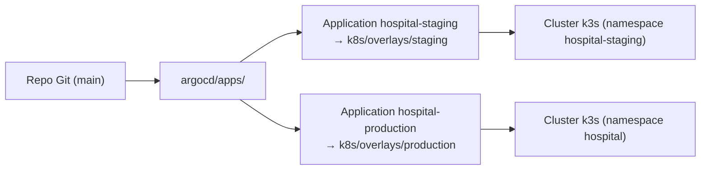

# GitOps (ArgoCD) — Centre Hospitalier

Déploiement **GitOps** de l'application sur k3s : ArgoCD synchronise
automatiquement le cluster avec le dépôt Git (les overlays kustomize).

## Architecture



## Installation

```bash
# 1. Installer ArgoCD (sur le nœud k3s)
make argocd:install          # ou : bash argocd/install.sh

# 2. Récupérer le mot de passe admin initial
make argocd:password

# 3. Déclarer le projet + les applications
make argocd:apps             # kubectl apply -f project.yaml -f app-of-apps.yaml

# 4. (Optionnel) Forcer la synchronisation
make argocd:sync
```

## Prérequis

- **Dépôt GitHub** : déjà configuré sur `https://github.com/Armel75/hospital_management_system.git`
  (dans `project.yaml`, `app-of-apps.yaml` et `apps/*.yaml`).
- **Accès GitHub** : configurer un secret pour ArgoCD
  (`argocd repo add https://github.com/...` avec un token).
- **Secrets** : ne jamais committer `k8s/base/secrets.yaml` en clair. Utiliser
  un **SealedSecret** (`sealed-secrets/example.yaml`) ou un secret applicatif.

## Secrets en GitOps (SealedSecrets)

1. Installer le contrôleur (une fois) :
   ```bash
   kubectl apply -f https://github.com/bitnami-labs/sealed-secrets/releases/download/v0.27.1/controller.yaml
   ```
2. Créer le SealedSecret :
   ```bash
   kubeseal --format yaml < secrets-values.yaml > sealed-secret.yaml
   ```
3. Committer le SealedSecret (jamais le Secret en clair).
   ArgoCD l'applique ; le contrôleur le décrypte dans le cluster.

## Déclenchement du déploiement

Le workflow GitHub `.github/workflows/deploy.yml` pousse les images immuables
(taguées SHA) sur GHCR **et** met à jour les tags des overlays kustomize.
ArgoCD détecte ensuite le changement et synchronise automatiquement.

---
