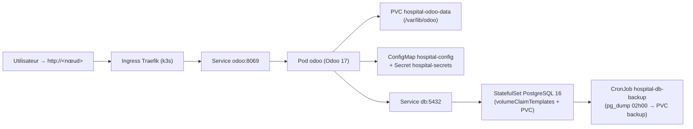

# Kubernetes (k3s) — Centre Hospitalier (Odoo 17)

Déploiement de l'application `hospital_management_system` sur un cluster **k3s**
(1 nœud). La stack est **entièrement dans le cluster** : PostgreSQL 16
(StatefulSet) + Odoo 17 (Deployment) + backups automatiques (CronJob).

> Cette structure est inspirée du projet **Audit** (`k8s/`) — kustomize,
> overlays staging/production, GitOps ArgoCD — adaptée à la stack Odoo.

## Architecture



> Le pod **odoo** génère son `odoo.conf` au démarrage : la ConfigMap fournit
> les valeurs **non sensibles** (`HOST`, `PORT`, `USER`…), le **Secret** fournit
> `POSTGRES_PASSWORD` (transmise par l'entrypoint officiel en argument CLI) et
> `ADMIN_PASSWORD` (injectée dans le fichier config). **Aucun secret en ConfigMap.**

## Prérequis

- Un cluster **k3s** opérationnel (`curl -sfL https://get.k3s.io | sh -`)
- `kubectl` (fourni par k3s)
- L'image `hospital-odoo` construite (Dockerfile racine)

## 1. Charger l'image dans k3s

Les images locales ne sont pas dans un registry : on les importe directement.

```bash
# Construire (comme d'habitude)
docker build -t hospital-odoo:1.0.0 .

# Importer dans k3s (mono-nœud)
docker save hospital-odoo:1.0.0 | sudo k3s ctr images import -

# Variante minikube :
minikube image load hospital-odoo:1.0.0
```

## 2. Configurer les secrets

```bash
# Éditer k8s/base/secrets.yaml et renseigner les vraies valeurs :
#   - POSTGRES_PASSWORD  (mot de passe du rôle "odoo" PostgreSQL)
#   - ADMIN_PASSWORD     (mot de passe master Odoo — clair ou hash pbkdf2)
```

> ⚠️ En GitOps (ArgoCD), ne committez **jamais** ce fichier en clair : utilisez
> un **SealedSecret** (`argocd/sealed-secrets/example.yaml`).

## 3. Déployer

```bash
make k8s:apply        # kubectl apply -k k8s/
make k8s:status       # kubectl get pods,svc,ingress -n hospital

# Suivi des pods
kubectl logs -n hospital -f deployment/odoo
kubectl logs -n hospital -f statefulset/db
```

## 4. Accéder à l'application

```bash
# IP du nœud (traefik expose le port 80)
# → http://<IP-DU-NOeUD>  (db_manager / base Odoo via l'UI)

# En dev (sans Ingress externe) :
kubectl port-forward -n hospital svc/odoo 8069:8069
# → http://localhost:8069
```

## 5. Sauvegardes

- **Base PostgreSQL** : CronJob `hospital-db-backup` (tous les jours à 02h00,
  `pg_dump` dans le PVC `hospital-backup-pvc`, rétention 7 jours).
  Déclenchement manuel :
  ```bash
  kubectl -n hospital create job --from=cronjob/hospital-db-backup backup-manual
  ```
- **Filestore Odoo** (`/var/lib/odoo`) : sauvegarder le contenu du PVC
  `hospital-odoo-data-pvc` (copie des fichiers, ou snapshot du volume).
  Les scripts `scripts/backup.sh` / `restore.sh` restent valables en
  docker-compose (dev) ; en K8s, privilégier le CronJob + snapshot PVC.

## Overlays (staging / production)

| Environnement | Namespace    | Image (surchargée par la CI/CD)      |
|---------------|--------------|--------------------------------------|
| Staging       | `hospital-staging` | `ghcr.io/armel75/hospital-odoo` (SHA) |
| Production    | `hospital`   | `ghcr.io/armel75/hospital-odoo` (SHA) |

```bash
# Appliquer un overlay précis :
kubectl apply -k k8s/overlays/staging
kubectl apply -k k8s/overlays/production
```

Pour le pull depuis GHCR, créer le secret d'imagePullSecrets (une fois) :

```bash
kubectl create secret docker-registry ghcr-pull \
  --docker-server=ghcr.io \
  --docker-username=<GH_USER> \
  --docker-password=<GH_TOKEN> \
  -n hospital
# Répéter pour hospital-staging
```

## GitOps (ArgoCD)

Voir `argocd/README.md` pour l'installation et la déclaration des applications.

## Notes importantes

- **Service `db` : le nom est OBLIGATOIRE** — la ConfigMap définit `HOST=db`
  (identique au service docker-compose). Si vous renommez le Service, Odoo ne
  joindra plus PostgreSQL.
- **Stockage** : `storageClassName: local-path` = disque du nœud k3s (mono-nœud).
  Pour plusieurs nœuds, remplacer par un stockage partagé (NFS, Longhorn…).
- **Replicas** : `replicas: 1` pour Odoo et PostgreSQL (volumes RWO).
  Pour scaler Odoo horizontalement, il faut un filestore partagé
  (ReadWriteMany) et un Postgres externe/managé.
- **`imagePullPolicy: IfNotPresent`** : images importées localement.
- **`admin_passwd`** : injecté depuis le Secret au démarrage. Si vous souhaitez
  utiliser le hash pbkdf2 existant (`config/odoo.conf`), placez-le dans le Secret.
- **Longpolling (8072)** : non exposé (comme en docker-compose). Les
  notifications temps réel d'Odoo utilisent ce port ; à exposer via l'Ingress
  si nécessaire.
- **Santé** : Odoo expose `/web/health` (readiness + liveness). Vérifier que le
  pod est `Ready` avant de pointer le DNS.

## Évolution vers Helm

Les manifests actuels suffisent pour k3s mono-nœud. Si vous voulez gérer les
versions / environnements proprement, on peut encapsuler ce déploiement dans un
**Helm chart** (`hospital-chart/`) avec `values.yaml`.

---
